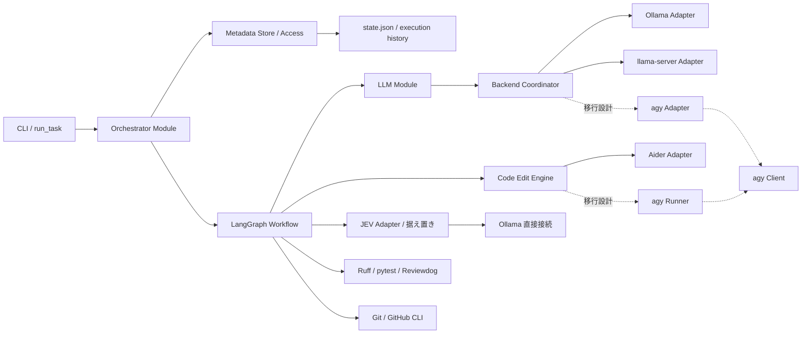
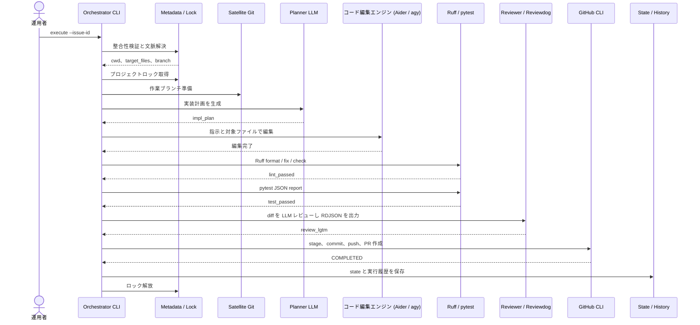
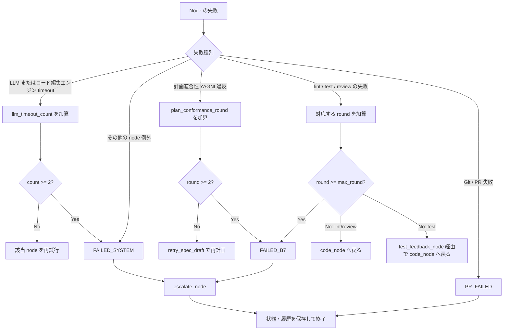

# 詳細設計書（コンポーネント詳細・データフロー・実装仕様）
**LangGraph / LLM Backend（Ollama・llama-server・agy）/ コード編集エンジン（Aider・agy）/ Ruff / Reviewdog 統合実装仕様**

| 項目     | 内容                                                                                                  |
| :------- | :---------------------------------------------------------------------------------------------------- |
| 文書番号 | SBOS-DD-003                                                                                           |
| 版数     | Rev.6.4（Epic #116: agy 移行設計の追記。JEV 据え置き。実装との食い違い訂正）                          |
| 改訂日   | 2026年11月4日                                                                                         |
| 作成日   | 2026年7月28日                                                                                         |
| 実装正本 | `tools/`、`config/models.yaml`、`metadata/.project-registry.json`、`metadata/projects/<PROJECT_KEY>/` |
| 対象読者 | 実装担当エンジニア、運用担当者、テスト担当者                                                          |

> **記載区分（Rev.6.4 以降）**: 本書は次の2区分を明示する。
> - **【現行】**: `develop` の実装で動作している内容。区分の表示が無い記述は、原則として【現行】である。
> - **【移行設計】**: Epic #116（JEV を除くローカルLLM使用箇所の agy への置き換え）で実装予定の内容。実装完了までは未実装であり、現状として扱わない。
>
> 移行設計の根拠と進捗は GitHub の Epic #116 と子 Issue（#117〜#129）を正とする。実装が完了した箇所は、該当 Issue のマージ時に【移行設計】の表示を外す。

---

## 1. 目的・適用範囲

本書は、衛星リポジトリの Issue を対象に、計画生成、コード編集、静的解析、テスト、LLM レビュー、PR 作成までを実行するオーケストレーターの詳細設計を定義する。実装の正本は本書ではなく `tools/` 配下のコードである。本書は、呼び出し側が知るべき Interface、状態遷移、不変条件、外部ツールとの seam、永続化・監査・運用上の制約を定義する。

対象は `orchestrator_graph.py` を中心とした実行基盤であり、衛星プロダクトの業務ロジック、優先度キャッシュの生成、モデル評価ツール `tools/model_test/eval_simpleqa.py` は対象外とする。

### 1.1 設計原則

- **実装正本**: Module の振る舞い・引数・例外は実装コードを正とし、本書では実装を複製しない。
- **隔離**: 母艦のメタデータ（Metadata Store）と衛星リポジトリを分離し、衛星内の Git 操作は解決済み `cwd` でのみ行う。
- **明示的な route**: LLM の intent は `config/models.yaml` の route でプロファイルへ明示的に対応付ける。（Rev.6.4 で `models.json` から訂正。loader が読むのは `models.yaml` のみ。SBOS-DD-005 §2）
- **fail-safe**: プロジェクト文脈、Git、LLM、品質ゲートの例外は状態・履歴へ記録し、安全に停止する。
- **最小権限**: コード編集エンジン（現行 Aider、移行後 agy）の編集対象と Git の stage 対象は `target_files` を基準に制限する。ただし実装上の拡張規則は §10 に記載する。

## 2. 全体アーキテクチャ



### 2.1 Module と Interface

| Module                      | Interface                                                                                  | 責務                                                                                                                                   |
| :-------------------------- | :----------------------------------------------------------------------------------------- | :------------------------------------------------------------------------------------------------------------------------------------- |
| `orchestrator_graph.py`     | `execute_issue()`、`cmd_orchestrate()`、`main()`                                           | 実行前検証、Git ブランチ準備、LangGraph 実行。                                                                                         |
| `metadata_store.py`         | `update_task_state()`, `record_execution_history()`, `write_event()`, `ProjectLockManager` | プロジェクト台帳・タスク状態・実行履歴・排他ロック管理。                                                                               |
| `sanitizer.py`              | `sanitize_text()`, `sanitize_data()`                                                       | 機密情報（キー、トークン、秘密鍵、パスワード、メール等）のマスキング。                                                                 |
| `config_loader.py`          | `load_model_config()`、各 `get_*_config()`                                                 | Pydantic による設定検証と設定値の提供。                                                                                                |
| `llm_client.py`             | `call_llm()`                                                                               | role・intent・設定からサニタイズ済み OpenAI 互換 API 呼び出しを構成。【移行設計】profile が `agy` のときは agy を呼ぶ（DD-005 §4.1）。 |
| `backend_coordinator.py`    | `BackendExecutionCoordinator.execute()`                                                    | intent の profile 解決、GPU リース、Backend Adapter 選択。【移行設計】`agy` は GPU リースなしで実行（DD-005 §5）。                     |
| `llama_backend.py`          | `managed_llama_server()`                                                                   | llama-server プロセスの起動、待機、終了、ポート解放確認。                                                                              |
| `aider_runner.py`           | `run_aider()`、`get_git_diff()`、`cleanup_unauthorized_aider_artifacts()`                  | Aider CLI 実行、Git 差分取得、`target_files` 外の後始末（エンジン非依存、DD-004 §2.1）。                                               |
| `agy_client.py`【移行設計】 | `run_agy_text()`、`run_agy_in_workdir()`                                                   | agy 実行ファイルの解決、起動、タイムアウト、プロセスツリーの終了（DD-004 §3）。                                                        |
| `agy_runner.py`【移行設計】 | `run_agy_edit()`                                                                           | agy による作業ツリーの直接編集と、`target_files` 外の後始末の呼び出し（DD-004 §3）。                                                   |
| `jev_adapter.py`            | `verify_plan_conformance()`、`verify_review_conformance()`                                 | JEV Core SDK (NoulTask) を用いた Zero-Decode 判定。**据え置き**（Ollama に直接接続、DD-005 §1.1）。                                    |
| `run_task.py`               | `clean_satellite_repository()`、`main()`                                                   | 排他ロック保護下でのクリーンアップおよびオーケストレーター起動ラッパー。                                                               |

### 2.2 ローカルLLM使用箇所の置き換えマップ（Epic #116）

JEV を除く、ローカルLLMを使う全箇所を agy へ置き換える。置き換えは、既存の `intent → routes → profile → backend adapter` の流れに `agy` を追加し、`routes` の向き先を切り替える形で行う。**呼び出し側のシグネチャと返り値は変えない。**

| #    | 使用箇所                                                  | 【現行】経路                                | 【移行設計】経路           | 詳細                     |
| :--- | :-------------------------------------------------------- | :------------------------------------------ | :------------------------- | :----------------------- |
| 1    | `code_node`（intent `aider_edit`）                        | Aider CLI → Ollama `coding_ollama`          | agy が作業ツリーを直接編集 | DD-004                   |
| 2    | `spec_draft_node`（`call_llm`、intent `spec_draft`）      | OpenAI 互換 API → Ollama `reasoning_ollama` | agy テキスト応答           | DD-005 §4.1              |
| 3    | `test_feedback_node`（intent `test_feedback`）            | 同上                                        | 同上                       | DD-005 §4.1              |
| 4    | `review_node`（intent `code_review`、`expect_json=True`） | 同上                                        | 同上（JSON 出力）          | DD-005 §4.1、DD-006 §3.1 |
| 5    | `escalate_node`（intent `failure_analysis`）              | 同上                                        | 同上                       | DD-005 §4.1              |
| —    | JEV（`jev_adapter.py`、`screen_issues.py`）               | Ollama `qwen2.5:0.5b` に直接接続            | **据え置き**               | DD-005 §1.1、DD-006      |

* 切り替えは `config/models.yaml` の `routes` の向き先を変えるだけで行う。移行の段階では旧 profile を削除せず、`routes` を戻すだけで従来の動作に戻せる（ロールバック）。
* agy の失敗時に、自動でローカルへフォールバックしない（§10.1）。
* 進捗: 契約検証 #117、`agy_client` #119、backend 追加 #120、`call_llm` 対応 #121、`code_node` 対応 #122、書き込み境界ガード #125、クォータ・障害中断ガード #126、新規ファイル許可 #102、routes 切り替え #123 まで実装完了。グラフ契約および状態遷移（外側契約）は完全不変。

## 3. 設定モデルとルーティング

LLM 関連設定の検証、Pydantic スキーマ、および intent に基づくプロファイルルーティングの詳細については、以下を参照すること。

👉 **[SBOS-DD-005_Backend_GPUリース仕様.md](SBOS-DD-005_Backend_GPUリース仕様.md)**

## 4. プロジェクト・メタデータ設計

ディレクトリ構成、メタデータ形式の詳細については、以下を参照すること。

👉 **[SBOS-DD-007_永続化_排他制御仕様.md](SBOS-DD-007_永続化_排他制御仕様.md)**

`resolve_project_context()` は順に `project.json.target_files`、`tasks.md` 内の Python パス、衛星内の Python ファイル探索から候補を得る。Issue 詳細ファイルに Target Files がある場合はそれを優先し、実在しない Python パスはファイル名の近似で衛星内ファイルへ補正する。衛星は `.git` が存在するディレクトリでなければ無効とする。

## 5. 実行ライフサイクル

### 5.1 実行開始前の契約

`execute_issue(issue_id, project_key, ..., resume=None, fresh=False)` は以下を順に実行する。

1. Issue ID とプロジェクトメタデータの整合性を検証する。
2. 衛星の `cwd`、対象ファイル、base branch、作業ブランチ prefix を解決する。無効な文脈ではコード編集エンジン（Aider / agy）を起動せず `FAILED_SYSTEM` を記録する。
3. `ProjectLockManager` で `metadata/projects/<PROJECT_KEY>/.lock` を取得する。競合時は `SKIPPED_LOCKED` と `LOCKED` を記録し、イベントファイルを作成して終了する。
4. Git ワークツリーを確認し、実行モードに応じて作業ブランチを準備する。
5. 初期 `GraphState` を生成して LangGraph を実行し、終了後に `state.json` と実行履歴を原子的に保存する。

### 5.2 Git ブランチ準備

| モード | 選択条件                                                                                   | 振る舞い                                                                                                                   |
| :----- | :----------------------------------------------------------------------------------------- | :------------------------------------------------------------------------------------------------------------------------- |
| Resume | `--resume`、または既存 state が `CHANGES_REQUESTED`、`PR_FAILED`、`FAILED_B7`、`IN_REVIEW` | 既存作業ブランチへ switch し、base branch へ rebase する（失敗時は中断）。未コミット差分は生成物を除いて WIP commit する。 |
| Fresh  | 上記以外、または `--fresh`                                                                 | base branch へ switch、`pull --ff-only`、既存の作業ブランチを削除し、base branch から再作成する。                          |

Fresh モードで既存の作業ブランチに未マージコミットがある場合（または未マージの監査に失敗した場合）は、強制削除せず `backup/<作業ブランチ>-<YYYYMMDDHHMMSS>` へリネームして退避してから再作成する。退避に失敗した場合は `FAILED_SYSTEM` で中断する。

**Resume の Git 安全性（Issue #92）**:

- **WIP コミットの対象**: dirty な作業ツリーは、生成物を除外して `git add -A -- . ':(exclude,glob)…'` でステージし、`wip: preserve uncommitted changes for <ISSUE_ID> before resume` でコミットする。除外対象は `tools/metadata_store.py` の定数 `GENERATED_ARTIFACT_GITIGNORE_ENTRIES`（`.aider*`、`.pytest_cache/`、`__pycache__/`、`.venv/`、`*.pyc`、`.ruff_cache/`、`.mypy_cache/`）から導出した `GENERATED_ARTIFACT_PATTERNS` で、dirty 判定と WIP の pathspec が共有する。同じ定義を `doctor.py` の `.gitignore` チェックと `ensure_satellite_gitignore` も使い、衛星の `.gitignore` に不足があれば警告・追記する（`.gitignore` が存在しない場合は新規作成しない）。照合はパスの要素単位で行い、`my.aider_notes.md` のような部分一致は除外しない。
- **WIP コミットの失敗**: `git add` の失敗、またはステージ済みの変更があるのに `git commit` が失敗した場合は、`FAILED_SYSTEM` で中断する。ステージ済みの変更が無い場合（除外後に何も残らない等）は、コミットを飛ばして続行する。
- **rebase の失敗**: base branch への rebase に失敗した場合は `rebase --abort` で元に戻し、衝突内容を記録して `FAILED_SYSTEM` で中断する。人が手動で解決するか、`--fresh` で作り直す。`FAILED_SYSTEM` は `consecutive_b7` を増やさず、自動 Resume の対象にもならない。

**連続 FAILED_B7 ガード**: `--resume` / `--fresh` を指定せず、既存 state の `status` が `FAILED_B7` で `consecutive_b7` が 2 以上のときは、自動 Resume を行わず実行を拒否して人に返す。この拒否では `state.json` を変更せず、拒否した事実だけを実行履歴に記録する。明示的な `--resume` / `--fresh` はこのガードを無視して実行できる。`consecutive_b7` の更新規則は §5.6 を参照する。

通常の実行で dirty working tree が見つかった場合は停止する。`allow_offline_git=True` を指定したプログラム呼び出しだけが、base branch の pull 失敗後も継続できる。作業ブランチの初期名は `project.json.work_branch_prefix` または `sbos/` と Issue ID の結合である。

### 5.3 GraphState

`GraphState` は LangGraph 内部の共有状態であり、外部永続化スキーマではない。

| 区分           | フィールド                                                                                                                   |
| :------------- | :--------------------------------------------------------------------------------------------------------------------------- |
| 識別・文脈     | `issue_id`、`project_key`、`execution_id`、`generation`、`cwd`、`base_branch`、`target_files`、`instruction`                 |
| 制御・失敗     | `status`、`error`、`error_category`、`llm_timeout_count`、`lint_round`、`test_round`、`review_round`、`max_round`            |
| 生成・品質結果 | `impl_plan`、`aider_message`、`test_feedback_instruction`、`lint_result`、`test_result`、`review_verdict`、`review_comments` |
| 監査結果       | `review_rounds`、`rdjson`、`reviewdog_result`、`history_summary`                                                             |

初期状態は `status='running'`、各 round と `llm_timeout_count` は 0、`max_round` は 3 とする。`TypedDict` は実行時検証を行わないため、各 node は存在しない任意値を `get()` または `setdefault()` で扱う。

#### Status taxonomy

| 区分                        | status                                                                                  | 役割・意味                                                      |
| :-------------------------- | :-------------------------------------------------------------------------------------- | :-------------------------------------------------------------- |
| 実行中・中間状態            | `running`、`code_completed`、`lint_passed`、`test_passed`、`review_lgtm`                | LangGraph のノード間を遷移する進行中状態。                      |
| 再試行指示                  | `retry_spec_draft`、`retry_code`、`retry_review`                                        | 各ノード（品質判定やタイムアウト）からの再実行シグナル。        |
| 終端・成功                  | `COMPLETED`                                                                             | PR 作成または既存 PR 検出により正常完了した終端状態。           |
| 終端・失敗/エスカレーション | `FAILED_SYSTEM`、`FAILED_B7`、`ESCALATED_NEEDS_REVISION`、`PR_FAILED`、`SKIPPED_LOCKED` | ロック競合、システムエラー、品質上限超過、PR 失敗等の終端状態。 |

この分類は文書上の整理であり、現行実装では `status` は任意文字列 (`str`) として保持される。実装自体は安定稼働しているため即時の全面書き換えは不要だが、次回以降のリファクタリングにおいて Python の `Literal` または `Enum` として型安全に厳密化する。新しい status を追加する際は、§5.5 の遷移表、`state.json`、実行履歴、統合テストを同時に更新する。

### 5.4 正常系シーケンス

正常系では、品質検証とレビューが1回で完了する。再試行・例外は §5.5 と §5.6 を参照する。



### 5.5 状態遷移表

| 実行 node            | 成功時の status と次 node                                         | 再試行時の status と次 node                             | 終端・停止                                                       |
| :------------------- | :---------------------------------------------------------------- | :------------------------------------------------------ | :--------------------------------------------------------------- |
| `spec_draft_node`    | `running` (計画適合) → `code_node`                                | `retry_spec_draft` (timeout または YAGNI違反) → 同 node | `FAILED_B7` (計画不適合上限) / `FAILED_SYSTEM` → `escalate_node` |
| `code_node`          | `code_completed` → `lint_node`                                    | `retry_code` → 同 node                                  | `FAILED_SYSTEM` → `escalate_node`                                |
| `lint_node`          | `lint_passed` → `test_node`                                       | `retry_code` → `code_node`                              | `FAILED_B7` / `FAILED_SYSTEM` → `escalate_node`                  |
| `run_pytest_node`    | `test_passed` → `review_node`                                     | テスト失敗 → `test_feedback_node`                       | `FAILED_B7` / `FAILED_SYSTEM` → `escalate_node`                  |
| `test_feedback_node` | `retry_code` → `code_node`                                        | —                                                       | `FAILED_SYSTEM` → `escalate_node`                                |
| `review_node`        | `review_lgtm` → `done_node`                                       | `retry_review` → 同 node、`retry_code` → `code_node`    | `FAILED_B7` / `FAILED_SYSTEM` → `escalate_node`                  |
| `done_node`          | `COMPLETED` → 終了                                                | —                                                       | `PR_FAILED` → 終了                                               |
| `escalate_node`      | `FAILED_B7` / `FAILED_SYSTEM` / `ESCALATED_NEEDS_REVISION` → 終了 | —                                                       | —                                                                |

### 5.6 例外・再試行フロー



`llm_timeout_count` は planner、コード編集エンジン（Aider / agy）、reviewer 間で共有される。異なる node の timeout も合算され、2回目で `FAILED_SYSTEM` となる。判定は例外メッセージの文字列（`timeout` / `timed out`）で行うため、**agy のタイムアウトのメッセージにも `timed out` を含めることが契約**である（DD-004 §3.2）。`spec_draft_node` の計画適合性（DoD YAGNI検問）が不適合（`rejected`）となった場合、`plan_conformance_round` を加算して最大2回まで再ドラフトを試行し、上限到達時は `FAILED_B7` となる。`escalate_node` は lint または test の上限到達時に敗因レポートの生成を試み、成功時は最終 status を `ESCALATED_NEEDS_REVISION` に更新する。

#### ラウンド上限の意味（Issue #91 で確定）

- `max_round`（既定 3）は、`lint_round`、`test_round`、`review_round` それぞれの**累積失敗回数**に対する上限である。フェーズを通過してもカウンタはリセットしない。
- 上限は「失敗 3 回目で `FAILED_B7`」を意味する（`round >= max_round` で停止。再試行は最大 2 回）。
- 各カウンタは `execute_issue` の開始ごとに 0 から数える。実行をまたぐ上限は、次の `consecutive_b7` が担う。
- 1 回の実行で `code_node` が走る最悪回数は、初回 1 + 各フェーズの再実行 (max_round - 1) × 3 + timeout 再試行 2 となる。`recursion_limit` はこれから算出する（`compute_recursion_limit`）。

#### 連続 FAILED_B7 回数（`consecutive_b7`）

`state.json` の Issue エントリに保持し、実行終了時の最終 status で次のとおり更新する。

| 最終 status                                                                               | `consecutive_b7`                         |
| :---------------------------------------------------------------------------------------- | :--------------------------------------- |
| `FAILED_B7`                                                                               | +1                                       |
| `COMPLETED`                                                                               | 0 に戻す                                 |
| `--fresh` で開始した実行                                                                  | 0 から数え直す（実行後の status で更新） |
| 上記以外（`FAILED_SYSTEM`、`PR_FAILED`、`ESCALATED_NEEDS_REVISION`、`SKIPPED_LOCKED` 等） | 変更しない                               |

`ESCALATED_NEEDS_REVISION` は自動 Resume の対象外（次回は Fresh）のため数えない。未設定のエントリは 0 として扱う。上限（`MAX_CONSECUTIVE_B7` = 2）に達した場合の挙動は §5.2 を参照する。

### 5.7 Node 契約

| Node                 | 成功時                                                                                                                                                                                                            | 再試行・エスカレーション                                                                                                                                                                                          |
| :------------------- | :---------------------------------------------------------------------------------------------------------------------------------------------------------------------------------------------------------------- | :---------------------------------------------------------------------------------------------------------------------------------------------------------------------------------------------------------------- |
| `spec_draft_node`    | planner 出力を `impl_plan` へ保存し、JEV 計画適合性ゲートで検証。適合（`passed`）なら `code_node` へ進行。                                                                                                        | YAGNI違反は制約フィードバックを付与し初回 `retry_spec_draft`、2回目は `FAILED_B7`。timeout は初回再試行、2回目は `FAILED_SYSTEM`。その他例外は `SYSTEM_ERROR`。                                                   |
| `code_node`          | コード編集エンジン（Aider / agy）の実行後、`.gitignore` の変更を戻し、Git 状態から変更済み Python ファイルを `target_files` に追加する。エンジンは `routes` が指す profile の `backend` で決まる（DD-004 §3.5）。 | timeout は初回 `retry_code`、2回目は `FAILED_SYSTEM`。その他のエンジンエラーは即時 `SYSTEM_ERROR`。外側契約はエンジンを問わず同一。                                                                               |
| `lint_node`          | 対象 Python がなければ `lint_passed`。Ruff の最終 check 成功で `lint_passed`。                                                                                                                                    | 失敗時は `LINT_ERROR` と `lint_round` を更新し、3回目で `FAILED_B7`。                                                                                                                                             |
| `run_pytest_node`    | pytest の JSON report を解析し、成功なら `test_passed`。                                                                                                                                                          | 失敗時は `TEST_ERROR` と `test_round` を更新し、3回目で `FAILED_B7`。実行・解析例外は `SYSTEM_ERROR`。                                                                                                            |
| `test_feedback_node` | reasoning LLM の助言を `test_feedback_instruction` と `aider_message` に保存する。                                                                                                                                | 助言作成失敗時も raw テスト出力を維持して `retry_code`。                                                                                                                                                          |
| `review_node`        | LLM 判定を実施し、`LGTM` の場合は JEV レビュー合否二次ゲート（`verify_review_conformance`）で検証。適合なら `review_lgtm` を確定して `done_node` へ進行。RDJSON・レビュー履歴を保存する。                         | JEV 不適合時は `changes_requested` に上書きし `aider_message` を付与して `code_node` へ差し戻し。指摘は 3 回目で `FAILED_B7`（それ以前は `retry_code`）。timeout は初回 `retry_review`、2回目は `FAILED_SYSTEM`。 |
| `done_node`          | 対象ファイルを stage・commit・push し PR を作成、または既存 PR を検出して `COMPLETED`。                                                                                                                           | Git/PR 操作失敗は `PR_FAILED` / `PR_ERROR`。                                                                                                                                                                      |
| `escalate_node`      | 最終状態を防御的に `FAILED_B7` または `FAILED_SYSTEM` とする。                                                                                                                                                    | lint/test の上限到達時は敗因レポート生成を試み、成功時は `ESCALATED_NEEDS_REVISION` とする。                                                                                                                      |

## 6. 外部ツール Adapter 契約

### 6.1 LLM Adapter & Backend Coordinator

LLMへのリクエスト構成、OpenAI互換APIエンドポイントの切り替え、およびGPUリソースのリース制御の詳細については、以下を参照すること。

👉 **[SBOS-DD-005_Backend_GPUリース仕様.md](SBOS-DD-005_Backend_GPUリース仕様.md)**

### 6.2 コード編集エンジン Adapter（Aider / agy）

Aider の起動オプション・一時ファイル制御・モデル解決、agy の編集実行仕様【移行設計】、`target_files` 外の後始末、フェイルセーフ仕様の詳細については、以下を参照すること。

👉 **[SBOS-DD-004_Aider統合仕様.md](SBOS-DD-004_Aider統合仕様.md)**（本書は編集エンジン全般の仕様に拡張されたが、他文書からのリンク維持のためファイル名は当面変更しない）

### 6.3 品質・レビュー Adapter

Ruff (lint)、pytest (test)、LLM レビューおよび Reviewdog の詳細仕様とエスカレーション処理については、以下を参照すること。

👉 **[SBOS-DD-006_品質ゲート_レビュー仕様.md](SBOS-DD-006_品質ゲート_レビュー仕様.md)**

### 6.6 Git・PR Adapter

`done_node` は次の順序を守る。

1. 既存 staged 変更を拒否する。
2. `target_files` のみを `git add --` し、stage 後のファイル集合が対象外を含まないことを検証する。
3. 未コミット差分があれば commit する。
4. `git fetch origin` 後、`git push --force-with-lease -u origin <head>` を実行する。
5. `gh pr list --head <head> --json number` で既存 PR を確認し、なければ `gh pr create` を実行する。

いずれかの Git または GitHub CLI 操作が失敗した場合、ブランチ・差分を巻き戻さず `PR_FAILED` と `PR_ERROR` を設定する。PR 作成に使用する head は現在 `sbos/<ISSUE_ID>` に固定されるため、`work_branch_prefix` を変更する場合は §12 の制約を確認すること。

## 7. 永続化・監査・排他制御

`state.json` および `execution_history.json` の永続化契約（fsync + 原子置換）、ならびに `ProjectLockManager` による排他制御（ロック取得・競合時の挙動）の詳細については、以下を参照すること。

👉 **[SBOS-DD-007_永続化_排他制御仕様.md](SBOS-DD-007_永続化_排他制御仕様.md)**

## 8. CLI・運用 Interface

### 8.1 オーケストレーター CLI

```text
uv run python tools/orchestrator_graph.py orchestrate [--project-key <PROJECT_KEY>]
uv run python tools/orchestrator_graph.py execute --issue-id <ISSUE_ID> [--project-key <PROJECT_KEY>] [--resume] [--fresh]
```

| コマンド      | 契約                                                                                                                                                          |
| :------------ | :------------------------------------------------------------------------------------------------------------------------------------------------------------ |
| `orchestrate` | 既存の `tools/.cache/priority-cache.json` から `issues`、互換形式として `tasks` を読み、score 降順の上位3件を表示する。キャッシュ生成・Issue 実行は行わない。 |
| `execute`     | Issue ID の prefix から project key を補完し、整合性検証後に `execute_issue()` を呼ぶ。                                                                       |
| legacy 入口   | サブコマンドなしでも `--issue-id` と `--project-key` が両方指定される場合だけ実行する。                                                                       |

### 8.2 run_task ラッパー

`run_task.py` は衛星のクリーンアップと `orchestrator_graph.py execute` の起動を担当する別 Interface である。`--dry-run` は実行予定だけを出力し、`--resume` はクリーンアップを省略する。既定では `git checkout -f <base>`、`git reset --hard origin/<base>`、`git clean -fd` を実行するため、未コミット変更・未追跡ファイルを破棄する。運用者は破壊的操作を理解した上でのみ利用すること。

## 9. セキュリティ・安全性の不変条件と制約

| 項目             | 実装上の保証・制約位置づけ                                                                                                                                                                                                                                                                                                                                                                      |
| :--------------- | :---------------------------------------------------------------------------------------------------------------------------------------------------------------------------------------------------------------------------------------------------------------------------------------------------------------------------------------------------------------------------------------------- |
| 母艦誤編集の防止 | 無効な台帳・衛星ディレクトリ・対象ファイルでは Graph を開始しない。                                                                                                                                                                                                                                                                                                                             |
| 並行実行         | 同一 project key は `run_task.py` を含め `ProjectLockManager`（`.lock`）により排他する。                                                                                                                                                                                                                                                                                                        |
| LLM の実行先     | intent は route を経由し、未定義 intent は拒否する。                                                                                                                                                                                                                                                                                                                                            |
| Aider のコミット | 【現行】Aider には `--no-auto-commits` を常に指定する。【移行設計】agy には commit / push をさせない（stage・commit・push・PR 作成は `done_node` が担当）。agy が `git` を操作しても、`target_files` 外の変更は後始末で戻され、stage 前検証が `target_files` 外を拒否する。                                                                                                                     |
| 外部送信         | 【現行】ローカルLLMのため、LLM へ送るデータは手元の GPU から出ない。【移行設計】agy はクラウド側のモデルを使うため、**ソースコード・diff・Issue 本文・ログが外部に送られる**。`call_llm` 経路は `sanitize_text` でマスクするが、編集経路は agy が作業ツリーを直接読むためマスクできない。方針（許可リスト等）は未決定で、移行直後は**全サテライトで許可された状態**として動かす（Issue #124）。 |
| 書き込み境界     | 【移行設計】agy は `--dangerously-skip-permissions` 相当で非対話実行されうる。移行直後の保護は、`target_files` 外の変更の後始末（DD-004 §2.1）のみ。母艦を `cwd` にしない検証、秘密情報ファイルの検出、未追跡ディレクトリの後始末は未対応（Issue #125）。                                                                                                                                       |
| Stage 前検証     | 既存 staged 変更を拒否し、`target_files` に含まれない stage 変更を拒否する（※Aider 後に追加された変更済み Python も検証対象）。                                                                                                                                                                                                                                                                 |
| レビューの差分   | Git diff が取得できない場合は review を失敗させる。                                                                                                                                                                                                                                                                                                                                             |
| Reviewdog        | 補助的な表示であり、失敗しても品質判定は継続する。                                                                                                                                                                                                                                                                                                                                              |
| 状態保存         | state と履歴は個別ロック・一時ファイル置換で保護する。                                                                                                                                                                                                                                                                                                                                          |

### 9.1 副作用一覧

システム全体における全コンポーネントの副作用を以下の表に集約する。

| 実行箇所                        | 副作用                                                                                                                                                                        | 影響範囲                       |
| :------------------------------ | :---------------------------------------------------------------------------------------------------------------------------------------------------------------------------- | :----------------------------- |
| `run_task.py`                   | ロック取得後、checkout, hard reset, clean で変更・未追跡ファイルを破棄する。                                                                                                  | 衛星ワークツリー               |
| `get_git_diff()`                | `git add -N .` を実行して未追跡ファイルを差分対象へ登録する。                                                                                                                 | 衛星 Git index                 |
| `code_node()` / Aider           | 対象ファイルを編集し、`.gitignore` の変更を戻す。                                                                                                                             | 衛星ワークツリー               |
| `code_node()` / agy【移行設計】 | agy が作業ツリーを直接編集し、`target_files` 外の変更を後始末で戻す。agy の成果物が作業ツリーに残る場合がある（名称は #117 で確認）。**サテライトの内容が外部に送信される。** | 衛星ワークツリー、外部サービス |
| `call_llm()` / agy【移行設計】  | 空の一時ディレクトリで agy を起動し、終了後に削除する。プロンプト（`sanitize_text` 済み）が外部に送信される。                                                                 | 一時ディレクトリ、外部サービス |
| `lint_node()`                   | Ruff format と `--unsafe-fixes` で対象 Python ファイルを修正する。                                                                                                            | 衛星ワークツリー               |
| `run_pytest_node()`             | `.report.json` を一時作成し、終了時に削除する。                                                                                                                               | 衛星ワークツリー               |
| `escalate_node()`               | lint/test の上限到達時に `FAILURE_REPORT_<ISSUE_ID>.md` を作成する。                                                                                                          | 衛星ワークツリー               |
| `done_node()`                   | `target_files` を stage・commit・`push --force-with-lease` し、PR を作成する。                                                                                                | 衛星 Git／リモート             |

副作用を伴う Module の変更時は、対象、失敗時の保持・復元方針、関連テストをこの表と §12 に反映する。

## 10. 現行仕様の制約・既知の実装差異・課題整理

### 10.1 現行仕様の制約

以下は現行実装の動作として受け入れる制約である。

1. **自動 backend fallback はない。** `fallback` 設定は検証されるだけで、Coordinator は route に指定された profile だけを実行する。【移行設計】この方針は agy 移行後も変えない。agy の失敗時に自動でローカルへ戻すと、品質比較と外部送信の許可リスト（Issue #124）を迂回するため、`FAILED_SYSTEM` として停止する。復旧は運用者が `routes` を戻して行う。
2. **`target_files` は事前確定の不変条件ではない。** コード編集エンジンの指示対象の制限および PR 前 stage 検証の対象として使われるが、編集実行後に発生した変更済み Python ファイルも自動追加される。
3. **Ruff はファイルを直接書き換える。** `--unsafe-fixes` を含むため、lint node は read-only の品質検査ではなくワークツリー変更を伴う。
4. **pytest-json-report が必須である。** プラグイン未導入時の fallback はない。対象テストが解決できない場合、ui/gui 名を除く既存テストを広く実行する。
5. **`run_task --resume --fresh` は相互排他ではない。** 両方指定時は resume の動作が優先される。
6. **通常実行の event は保存しない。** events ディレクトリへの記録が確認できるのはロック競合時である。
7. **設定変更はプロセス再起動で反映される。** `lru_cache` を利用しているため、常駐プロセス化しない現行 CLI 運用ではプロセス再起動が必要となる。`routes` の切り替え（ロールバックを含む）も同様である。
8. **【移行設計】agy 経路では `temperature` / `max_tokens` を指定できない前提とする。** 出力の揺らぎが Ollama 経路より大きい可能性がある。指定手段の有無は Issue #117 で確認する。
9. **【移行設計】agy 経路の失敗種別は区別されない。** 認証切れ・クォータ切れ・その他の非0終了は、移行直後は同じ `FAILED_SYSTEM`（`SYSTEM_ERROR`）として扱われる。夜間に認証切れが起きると、全タスクが連続して失敗しうる。分類と連続失敗時の中断は Issue #126 で扱う。
10. **【移行設計】JEV は Ollama に依存し続ける。** agy 移行後も、JEV の判定を有効にするには Ollama の起動と `qwen2.5:0.5b` の配備が必要である（DD-005 §1.1）。

### 10.2 既知の実装不整合と改修状況

1. **`run_task.py` のロック非取得クリーンアップ【Rev.6.0 で改修済み】**
   - 以前はロック取得前に cleanup を実行していたが、`ProjectLockManager` 内で cleanup および orchestrator 呼び出しを行うよう修正。
2. **作業ブランチ prefix の不一致【Rev.6.0 で改修済み】**
   - PR 作成時（`done_node`）に `sbos/<ISSUE_ID>` がハードコードされていたが、`GraphState` で `work_branch_prefix` を保持し動的適用するよう修正。
3. **`GraphState` の `test_feedback_instruction` の初期値**
   - 型定義上必須だが初期 state では未設定である。各 node は `.get()` を使用するため実行時には支障ない。
4. **`status` の Enum / Literal 化および Metadata モジュールの独立分離【Rev.6.1 で改修済み (Issue #22)】**
   - `tools/metadata_store.py` を新設し、`TaskStatus` / `ErrorCategory` Enum & Literal を導入して型安全性を担保。
   - プロジェクト台帳、タスク状態（`state.json`）、実行履歴（`execution_history.json`）、排他ロック管理（`ProjectLockManager`）を独立分離。
5. **機密情報マスキング・サニタイズ共通モジュール `tools/sanitizer.py` の導入【Rev.6.2 で改修済み (Issue #20)】**
   - `tools/sanitizer.py`（`sanitize_text`, `sanitize_data`）を新設。
   - APIキー、アクセストークン、秘密鍵、Basic認証URL、Key-Valueシークレット、メールアドレス（RFC 2606テストドメイン除外）等のマスキング基盤を確立。
   - `tools/llm_client.py`（プロンプト送信直前）、`tools/metadata_store.py`（履歴・イベント保存直前）、`orchestrator_graph.py`（Failure Report出力時）の全境界へ統合完了。

### 10.3 要件決定が必要な事項

- **`target_files` の厳密な境界要件**: 今後、コード編集エンジンによる意図しない他ファイル変更を完全にブロックするため、事前許可リスト以外の変更をエラーとするか（厳密な不変条件）、現状の柔軟な追記を許容するかを決定する。agy は Aider より自律的にファイルを触れるため、重要度が上がる（Issue #125）。
- **【移行設計】外部送信の方針**: agy へ送られるデータ（Issue 本文・計画・diff・ログ、および編集経路で agy が読む作業ツリー）の許容範囲を決める。ローカルLLMを採用した元の動機に「コードを外部に出さない」が含まれていたかの確認を要する。サテライト単位の許可リスト（opt-in）を推奨案とする（Issue #124）。
- **【移行設計】agy の障害時方針**: 認証切れ・クォータ切れの扱い、リトライとバックオフ、連続失敗時の中断、内側 / 外側タイムアウトの見直し（Issue #126）。
- **【移行設計】旧資産の退役条件**: 品質比較（Issue #127）の合格基準を満たした後に、旧 profile・Aider・llama-server 基盤を削除する（Issue #128）。

### 10.4 将来のリファクタリング候補

- **`run_task.py` と CLI の責務整理**: 破壊的クリーンアップ機能と通常実行の連携のさらなる整理。

## 11. テスト・検証設計

| テスト                                                                                  | 対応する Interface・契約                                                                                                                                                          |
| :-------------------------------------------------------------------------------------- | :-------------------------------------------------------------------------------------------------------------------------------------------------------------------------------- |
| `tests/test_orchestrator_aider_integration.py`                                          | Issue/プロジェクト検証、文脈解決、timeout、状態遷移、Ruff・pytest、レビュー/RDJSON/Reviewdog、PR branch prefix、履歴、CLI、resume を統合検証する。                                |
| `tests/test_aider_runner.py`                                                            | Git diff、初回 commit 前 fallback、Aider 引数・timeout・非ゼロ終了、一時ファイル削除、`/v1` 除去を検証する。                                                                      |
| `tests/test_backend_coordinator.py`                                                     | intent route、Ollama/llama-server Adapter、GPU リース、未定義 intent、Ollama 到達不能時の llama-server 起動を検証する。                                                           |
| `tests/test_llm_client.py`                                                              | role 設定、OpenAI SDK へのパラメータ伝達、intent 補完を検証する。                                                                                                                 |
| `tests/test_run_task.py`                                                                | ロック保護下でのクリーンアップ順、resume 時の skip、dry-run の非実行性を検証する。                                                                                                |
| 【移行設計】`tests/test_agy_client.py`                                                  | agy の実行ファイル解決、タイムアウト、**プロセスツリーの終了**、非0終了・未導入の例外化（`subprocess` はモック。ツリー kill は子プロセスを生成するダミースクリプトで検証）。      |
| 【移行設計】`tests/test_agy_runner.py`                                                  | `run_agy_edit` の成功・タイムアウト（`timed out` を含む）・非0終了、`target_files` 外の後始末が呼ばれること。                                                                     |
| 【移行設計】`tests/test_llm_client.py`（追加）                                          | agy 経路の通常テキスト・JSON（コードフェンス付き・前置き付き）・抽出失敗時のフォールバック・`sanitize_text` 適用後の文字列が渡ること。OpenAI 経路の既存テストが無変更で通ること。 |
| 【移行設計】`tests/test_config_loader.py` / `tests/test_backend_coordinator.py`（追加） | `agy` profile の検証、既存 backend の必須項目が弱まっていないこと、agy 実行時に GPU リースを取得しないこと。                                                                      |

### 11.1 保証範囲

| 検証層            | 現在の保証（モックベース検証）                                                                          | 未保証・実環境接続が必要な検証（smoke test）                                                                                                                                                                                                                           |
| :---------------- | :------------------------------------------------------------------------------------------------------ | :--------------------------------------------------------------------------------------------------------------------------------------------------------------------------------------------------------------------------------------------------------------------- |
| Unit / 契約テスト | 設定解決、Aider 引数・例外、Backend route、LLM パラメータ、run_task のロック・分岐をモックで検証する。  | 実行ファイルのインストールや外部サービスの可用性。                                                                                                                                                                                                                     |
| 統合テスト        | LangGraph の状態遷移、監査保存、Git/PR の失敗正規化、レビュー結果の構造化を隔離環境とモックで検証する。 | 実 Git remote、実 GitHub PR、実 LLM (Ollama/llama-server) の応答品質。                                                                                                                                                                                                 |
| 実環境 smoke test | 自動テストスイートには含まれない（分離運用）。                                                          | Ollama、Aider、Ruff、pytest、Reviewdog、GitHub CLI、リモート Git を実接続した最小 Issue の完走検証。【移行設計】agy を実接続し、`spec_draft` から `done` まで完走する検証（Issue #123）。agy の実機テストは `integration` マーカーで分離し、CI は agy に依存させない。 |

実環境 smoke test は、衛星リポジトリを破壊しない専用の一時 repository と Issue を用意して別の運用手順として実施する。

```bash
uv run pytest
uv run ruff check tools tests
```

## 12. 変更時の設計判断

- 新しい LLM 用途を追加する場合は、role・intent・route・profile・テストを同時に追加する。暗黙の model 選択を導入しない。
- 【移行設計】agy 経路を呼び出し側（各ノード）に `if agy:` として散らさない。分岐は backend の種別を見る箇所（Backend Adapter、`call_llm` の内部、`code_node` の `_do_aider`）に限る。
- 【移行設計】agy へ送るデータの範囲を広げる変更（読み取らせるファイル、プロンプトに含める情報）は、外部送信の方針（Issue #124）への影響を、この文書の §9 に反映する。
- 【移行設計】JEV には触れない。JEV を agy へ移す変更は、本書の範囲外で別途設計する（logprobs への依存があるため）。
- 新しい終端状態を追加する場合は、Graph の route、`state.json`、実行履歴、運用手順、統合テストを同時に更新する。
- Git 操作を追加する場合は、衛星 `cwd`、対象ファイル制限、失敗時の差分保持、破壊的操作の有無をこの文書に記載する。
- 新しい外部ツールは、Module の Interface、例外変換、timeout、テスト用 seam を定義してから Graph node へ接続する。
- 本書にコード全文を複製しない。関数シグネチャ、状態遷移、永続化形式、外部コマンド契約の変更を伴う実装変更だけを追記・更新する。
